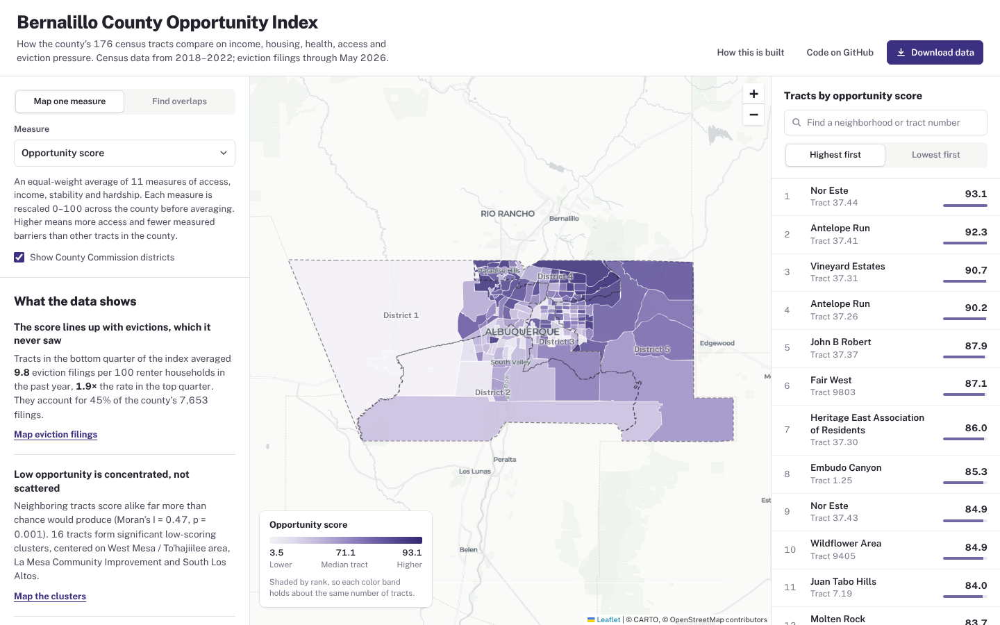
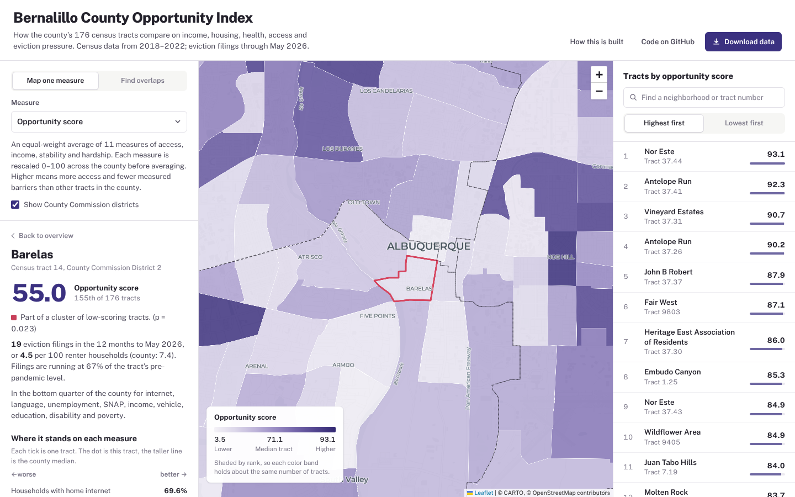

# Bernalillo County Opportunity Index

An interactive, tract-level map of opportunity and eviction pressure across Bernalillo County, New Mexico (Albuquerque and the surrounding county).

**Live site:** https://edwardyang88.github.io/BernalilloCountyMap/



## What it shows

- **An opportunity score for all 176 census tracts.** The score combines 11 measures from the American Community Survey and a hospital-distance dataset: income, poverty, housing cost burden, SNAP use, unemployment, education, health insurance, home internet, vehicle access, disability and distance to a hospital.
- **Measured eviction filings.** Court filings from the Eviction Lab's Eviction Tracking System, shown per 100 renter households for the most recent 52 complete weeks. Filings are kept out of the score, so they serve as an independent check on it.
- **Spatial clusters.** Local Moran's I (LISA) separates real geographic concentrations of high and low scores from single outlier tracts.
- **A profile for every tract.** Click any tract to see where it ranks against the other 175 tracts on every measure, its cluster status and its eviction record.
- **Overlap search.** Find tracts in the worst or best quarter of the county on two measures at once, for example high eviction filings and high uninsured rates.



## Findings

Numbers are regenerated by the pipeline. These figures cover filings through May 9, 2026.

- **The score lines up with an outcome it never saw.** Tracts in the bottom quarter of the score averaged 9.8 eviction filings per 100 renter households, 1.9 times the rate in the top quarter. They account for 45% of the county's 7,653 filings. The rank correlation between score and filing rate is −0.38.
- **Low opportunity is concentrated.** Global Moran's I is 0.47 (p = 0.001, 999 permutations). Sixteen tracts form statistically significant low-scoring clusters. They center on the West Mesa / To'hajiilee area, La Mesa, South Los Altos, the Southwest Mesa and Trumbull Village.
- **District 3 carries the heaviest load.** It contains 17 of the county's 44 bottom-quarter tracts and 40% of all eviction filings.

## How the score is built

1. Pull 2018–2022 ACS 5-year estimates from the Census API, using tables B28002, S2503, S2701, S1701, S1901, S1810, S1501, S2201, S2301, B08201 and C16002. Clean Census missing-value codes.
2. Rescale each measure from 0 (worst tract in the county) to 100 (best). Flip the measures where a higher number is worse.
3. Average the 11 measures with equal weights. Limited-English households and an ACS-only eviction-risk estimate are mapped for reference but left out of the score.
4. Add measured eviction filings, LISA clusters (queen contiguity, conditional randomization), county rank and commission district (`bern_enrich.py`).

The map colors tracts by rank rather than raw value, so a single extreme tract can't wash out the rest of the county.

## Limitations

- ACS tract estimates have wide margins of error. Small differences between tracts are noise.
- Equal weights are a modeling choice, not a finding. Min-max rescaling is sensitive to the county's most extreme tract.
- Eviction filings are not completed evictions, and informal evictions never reach court. Tracts with fewer than 50 renter households get no filing rate.
- Hospital distances are from 2017 and are straight-line distances, not travel times.

## Repository

| Path | What it is |
|---|---|
| `index.html`, `app/` | The web app: React + Leaflet, no build step |
| `bern_uoi_pipeline.py` | Pulls ACS and TIGER data, builds the score, writes `data/tracts.json` |
| `bern_enrich.py` | Adds eviction filings, LISA clusters, ranks and districts; writes `data/summary.json` and the public CSV |
| `data/bernalillo_opportunity_index.csv` | Clean download of every tract, measure and score |
| `data/eviction_lab/` | Eviction Tracking System extracts and renter household counts |

### Rebuild the data

```bash
pip install pandas geopandas requests numpy
python bern_uoi_pipeline.py      # runs bern_enrich.py at the end
python -m http.server 8000       # then open http://localhost:8000
```

`bern_enrich.py` needs only pandas and numpy. To refresh just the eviction data and clusters, run it on its own.

## Sources

- U.S. Census Bureau, American Community Survey 5-year estimates, 2018–2022.
- U.S. Census Bureau, TIGER/Line Shapefiles, 2022.
- Peter Hepburn, Renee Louis and Matthew Desmond. *Eviction Tracking System: Version 2.0.* Princeton: Princeton University, 2020. [evictionlab.org](https://evictionlab.org)
- Bernalillo County, County Commission district boundaries.
- Basemap © CARTO, © OpenStreetMap contributors.

Built by Edward Yang.
